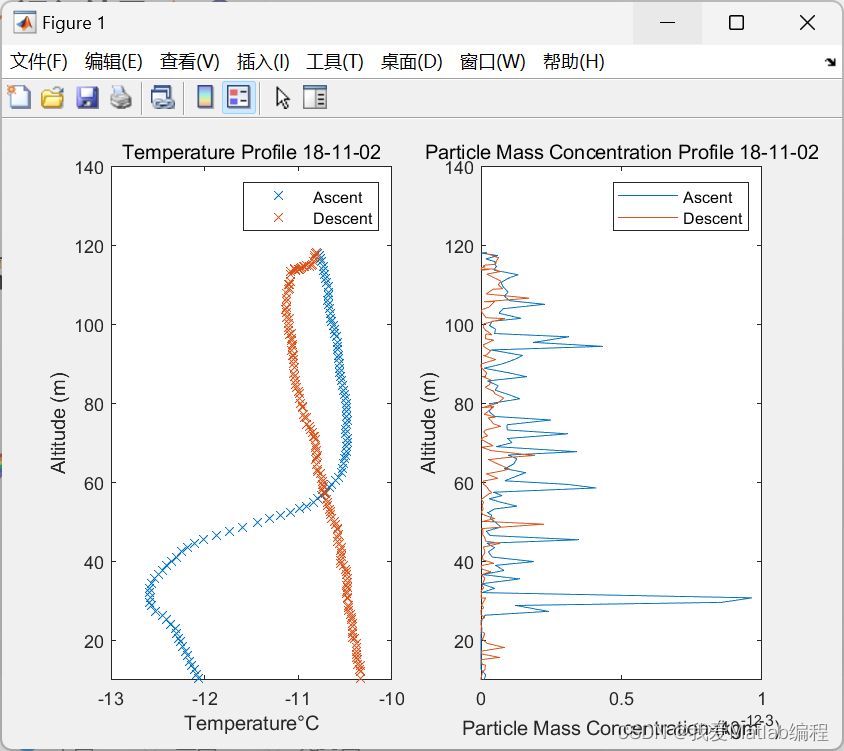

# Drone Meteorological Data Acquisition System Design (Matlab Code Implementation)

📚2 Run Result Editing
Part of the code:
[profiles,pindex] = detect_profile(metdat);  
altitudes = [10,50,70,100,120];  
slicestruct = sliceData(profiles,altitudes,pindex,counts);  
intParams = colint(profiles);  
if outfile == true  
genfile('SAM_DATA',log_file,pix_file,date,profiles);  
end  
if plotdata == true  
fig = figure(1);  
ax1 = subplot(1,2,1);  
tln1 = plot([profiles.profile_1.temperature],[profiles.profile_1.altitude],'x');  
hold on  
tln2 = plot([profiles.profile_2.temperature],[profiles.profile_2.altitude],'x');  
hold on  
ylim([10,140])  
xlabel(sprintf('Temperature%cC',char(176)));  
ylabel('Altitude (m)');  
title(['Temperature Profile ',date])
legend(ax1,{'Ascent','Descent'},'Location','northeast')  
ax2 = subplot(1,2,2);  
mln1 = plot([profiles.profile_1.particle_mass_conc],[profiles.profile_1.altitude]);  
hold on  
mln2 = plot([profiles.profile_2.particle_mass_conc],[profiles.profile_2.altitude]);  
hold on  
ylim([10,140])  
xlabel('Particle Mass Concentration (kgm^-^3)');  
ylabel('Altitude (m)');  
title(['Particle Mass Concentration Profile ',date])  
legend(ax2,{'Ascent','Descent'},'Location','northeast')  
hold off  
end  
🎉3 References
🌈4 Matlab code implementation

## Images

<!-- PAYMENT_BLOCK -->

## Get this dataset

- Payment link (Stripe): [Buy now](https://buy.stripe.com/3cs8yP7sY87d0vu9AB)
- Payment QR code: 

<!-- /PAYMENT_BLOCK -->
